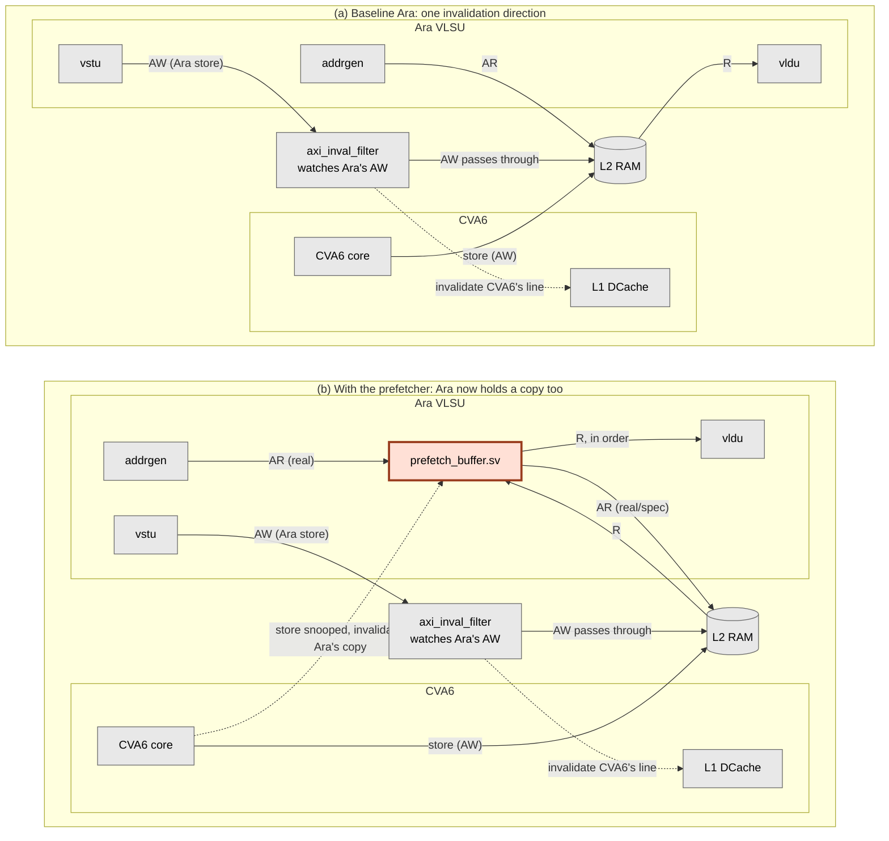
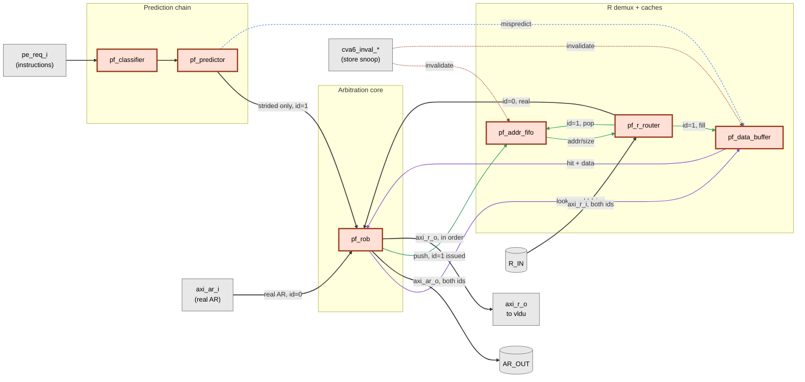

# A Hardware Prefetcher for Ara's Vector Load/Store Unit

**ECE 499 Engineering Project, Final Report (DRAFT for review, not yet final)**

**Student:** Catherine Ye
**Supervisor:** Professor Hiren Patel
**Term:** Spring 2026
**Branch:** `caz/dev`, ARA fork (`Malulim/ara-hardware-vector-prefetcher`)

> **Note to self before finalizing:** page count still needs checking against the 25-page cap once this is rendered. Anything in *italics* still needs a decision from you.

---

## Summary

Ara is an open-source RISC-V vector coprocessor. Its vector load/store unit (VLSU) issues every AXI memory request under one fixed transaction ID, then leans on AXI4's per-ID ordering rule to keep data arriving at the vector load unit (vldu) in program order. This project adds a hardware prefetcher to that load path.

The idea is specific to RISC-V Vector (RVV) code. A conventional CPU prefetcher works the stride out from a history of addresses it has watched go past. An RVV load instruction states its own access pattern, so the classifier can read the current instruction's stride directly instead of inferring it from address history. The predictor then decides whether a later vector load will continue that pattern.

The prefetcher observes PE requests entering the VLSU, classifies each vector load and predicts where a later load continuing the same pattern would start. A saturating confidence counter decides whether to trust that continuation. Each qualifying strided-load instruction can trigger one speculative AXI read for the next predicted base address, allowing the fetch to begin before that later load's real memory request exists. Strided loads are the case worth going after, since a unit-stride burst already amortises its round trip across the whole burst. Results land in a small buffer. A reorder buffer at the real-request point keeps a speculative hit from being released ahead of an older real miss that is still outstanding, which is the one property the design cannot afford to get wrong.

Holding data in that buffer creates a coherency problem the baseline never had, since baseline Ara caches nothing. If CVA6 writes to an address the prefetcher already fetched, the buffered value goes stale, and software synchronisation cannot fix it, because the read has already happened. The prefetcher therefore watches CVA6's store addresses. It clears any matching buffer entry, and poisons the entry instead if the fetch is still in flight.

The implementation is seven new SystemVerilog modules. Unit-level tests cover the ordering property and both halves of the coherency path, and the full CVA6+Ara system elaborates cleanly under Verilator. End-to-end simulation of a real compiled program did not get finished. The blocker was setting up the simulation environment. That, along with a performance evaluation on real benchmarks, is left as future work.

---

## Table of Contents

1. Introduction
2. Background: How Ara's Memory Path Works
3. Design
   3.1 Scope and Constraints
   3.2 Architecture
   3.3 Module Breakdown
   3.4 Key Design Decisions
   3.5 Coherency
4. Verification
   4.1 Unit-Level Verification
   4.2 System Integration
   4.3 What Has Not Been Verified, and Why
5. Results
6. Limitations and Future Work
7. Conclusion
Cost Comparison
References

---

## 1. Introduction

Ara [1] is an open-source vector coprocessor implementing the RISC-V Vector (RVV) extension. It runs alongside the CVA6 [2] scalar core. The L2 SRAM model answers in one cycle, but a load takes longer than that to come back. Most of the extra time goes to the AXI cuts and the interconnect between the VLSU and memory, and the round trip stays roughly the same whatever the access pattern is. *(Design work used a working figure of about 7 cycles. That number needs measuring before it goes in the final report, and Section 5.3 leans on it.)* If the access pattern is known ahead of time, that latency looks worth hiding.

Conventional CPU prefetchers work the stride out themselves, from a history of addresses they have already seen. IP-stride prefetchers and SPP [3] both do this. RVV removes that classification step: `vle` is unit-stride, and `vlse` is strided and names its stride in a scalar register. The predictor uses that information to test whether a future instruction continues the pattern. This project asks what the instruction-provided information is worth, and builds a prefetcher inside Ara's VLSU to find out.

---

## 2. Background: How Ara's Memory Path Works

Three properties of Ara's existing VLSU had to be pinned down from source (`addrgen.sv`, `vlsu.sv`, `vldu.sv`, `vstu.sv`) before any design work started. Each one limits what a prefetcher can do.

**Every AXI request Ara issues uses transaction ID 0.** Three separate places build an AR packet, for unit-stride, strided and indexed accesses. All three fill it with `default: '0` and never set `id`. Ara therefore depends completely on AXI4's rule that requests sharing an ID come back in order. It does no tagging and no reordering of its own, and `vldu` has neither a reorder buffer nor an ID-indexed scoreboard. Anything a prefetcher hands back to `vldu` has to arrive in the order the real requests went out.

**`vldu` gets addresses from a side metadata queue, never from the R channel.** The same cycle `addrgen` issues an AR or AW, it pushes `{addr, size, len, is_load, is_exception}` into a shared `fifo_v3`. `vldu` and `vstu` take the head entry, one or the other. When R data arrives, `vldu` reads only `axi_r_i.data`, and it gets the address and width for the valid byte window from the metadata queue head. Nothing in the file reads `axi_r_i.id` or `axi_r_i.resp`. The queue stays lined up on its own as long as R order matches AR issue order, so a prefetcher can leave it alone.

**The AXI4 R channel carries no address.** It has `id`, `data`, `resp`, `last` and `user`. AXI matches a returning beat to its request through strict per-ID ordering, with no explicit tag. That is a deliberate simplification in the protocol, and it pushes the bookkeeping onto whoever needs to know an address. Ara's mainline code never has to ask, since everything is `id=0` and order is trusted. A prefetcher does need the address of a returning beat, for buffering and tag comparison, so it has to keep that record itself.

---

## 3. Design

### 3.1 Scope and Constraints

The design covers `vle` and `vlse`, unit-stride and strided loads. Indexed loads (`vlxe`) are out of scope, since their addresses live in a vector register and only exist at runtime. Stores are never prefetched.

The classifier also rejects segment loads (`vlseg`) on opcode, though that exclusion is thinner than it looks. `segment_sequencer.sv` rewrites a unit-stride segment load into a run of `VLSE` micro-ops before the VLSU ever sees it, so they reach the prefetcher as ordinary strided loads. That seems safe enough, since each micro-op carries a real base address and a real stride, and a prefetch against one asks for memory the program is about to read anyway. Whether it helps or just wastes bandwidth needs the benchmarks in Section 6.

Within that scope, only strided loads produce real speculative AXI reads. A new qualifying PE request is the trigger: once confidence has been established, that instruction can produce one read for the next predicted base. The classifier and predictor still run for unit-stride loads, in an observe-only mode that Section 3.4 explains. Coherency between CVA6 stores and the prefetch buffer is in scope, and Section 3.5 covers it.

### 3.2 Architecture

The prefetcher is one new module, `prefetch_buffer.sv`, dropped onto Ara's AR/R load path between `addrgen` and the AXI cut. It leaves `addrgen.sv`, `vstu.sv` and the shared metadata FIFO alone. `vldu` has no idea it is there, which was a deliberate choice. Figure 1 puts it in system context, next to the baseline it sits on top of.

**Figure 1: System-level block diagram, before and after.** Panel (a) is baseline Ara. Panel (b) adds this project's contribution, the shaded block. Everything else is existing Ara and CVA6 infrastructure. Only the channels each block acts on are drawn, so `axi_inval_filter` appears on the store path alone, even though Ara's other AXI channels physically pass through it untouched.

The two panels differ by one block and one edge. Baseline Ara keeps no copy of memory anywhere, so only one invalidation direction exists, and `axi_inval_filter` provides it. That block is easy to misread. It is not a CVA6 block. It sits in Ara's own write path, watches Ara's AW, and hands each store address to CVA6 so CVA6 can drop the matching line from its L1. The cache it protects belongs to CVA6, and Ara has none of its own to protect.

`prefetch_buffer.sv` puts a copy of memory inside Ara for the first time, and that creates the second direction. A CVA6 store now has to reach into Ara as well. The dashed edge in panel (b) carries it, and Section 3.5 covers what the two structures inside the block do once it arrives.

### 3.3 Module Breakdown

Figure 2 opens up the shaded block. Seven modules sit inside it, in three groups. A prediction chain turns an instruction into a candidate address. A single arbitration core owns the shared AR channel and the release order to `vldu`. A demux stage files returning R data by ID. The table below gives each module's responsibility.

**Figure 2: Inside `prefetch_buffer.sv`.** All seven modules shown are this project's contribution. The grey blocks are ports crossing the module boundary, not hardware. Real traffic carries `id = 0` and speculative traffic carries `id = 1`. The two merge onto one physical AR channel at `pf_rob` and split apart again at `pf_r_router`, and that ID is the only thing telling them apart on the way back. Line colour groups the traffic: black is the main request and data flow, purple the buffer lookup, green the speculative-side bookkeeping, blue the mispredict flush, orange the coherency invalidation.

| Module | Responsibility |
|---|---|
| `prefetch_buffer.sv` | The top level, and the only module `vlsu.sv` instantiates. Wiring only, with no decision logic of its own. It instantiates the six below, packages a granted prediction into a single-beat AR with `id = 1`, and fans the CVA6 store snoop out to the two structures that hold copies of memory. |
| `pf_classifier.sv` | Decodes `vle` and `vlse` into `{prefetchable, byte_stride, size, is_strided}` straight from the instruction fields. RVV encodes the pattern, so nothing has to be inferred. Everything else, including indexed loads, segment opcodes and all stores, falls through as not prefetchable. |
| `pf_predictor.sv` | Predicts the next instruction's base address as `scalar_op + vl × byte_stride`. One formula covers both `vle` and `vlse`, since the classifier already supplies `byte_stride`. A 2-bit saturating confidence FSM gates the output: `NO_PRED → TRANSIENT → STEADY`, and one mispredict drops it straight back to `NO_PRED`. Only strided predictions get past that gate (Section 3.4). Unit-stride ones still update the FSM, then get dropped here and never reach the AR channel. |
| `pf_addr_fifo.sv` | Records `{addr, size}` for every outstanding speculative AR, in issue order, since AXI's R channel does not echo the address back. Its occupancy doubles as the throttle. A full FIFO withholds the grant for the next speculative AR, so no separate in-flight counter is needed. |
| `pf_rob.sv` | The correctness-critical module. It arbitrates real against speculative AR for the shared AR channel, where real traffic always wins. It then releases R data to `vldu` strictly in the order the real ARs went out. How a request resolved, by buffer hit or by real miss, makes no difference to when it is released. |
| `pf_r_router.sv` | Splits returning R data by ID. A speculative result whose `resp` is not `OKAY` gets dropped instead of cached. It routes on `id == 1` and treats everything else as real traffic, which works because this design adds the only second ID in the system. |
| `pf_data_buffer.sv` | A small fully-associative cache of speculative results, keyed on `{addr, size}`. Keying on `addr` alone would let a wider access hit an entry cached for a narrower one, handing back bytes that were never fetched. Depth is a parameter, currently 4. |

### 3.4 Key Design Decisions

**Prediction is PE-request-triggered and one step ahead.** The first qualifying PE request establishes a candidate for the next base. A later matching request raises confidence and may trigger one speculative AR for the following base, before that following instruction has produced a real AR of its own.

**Only strided loads get real prefetches.** A unit-stride load issues one large burst AR and spreads the round trip across the whole burst, so per element it is already cheap. A strided load issues one small AR per element and pays the full round trip every time, which is where a prefetcher has something to win. The risk is lopsided as well. A wrong unit-stride prefetch throws away a whole burst of bandwidth, while a wrong strided one costs one small request. Taking the bigger risk while the core mechanism was still unproven did not seem worth it. Unit-stride loads still run through the classifier and predictor and still build confidence-FSM state, so the path can be switched on later without redoing that groundwork.

**The address-tracking FIFO exists because AXI does not report the address back.** This follows straight from Section 2. Without a side record of what was asked for, a returning speculative beat cannot be filed into the data buffer under the right `{addr, size}` key. Its push and pop rhythm copies what `addrgen` and its metadata FIFO already do for the real path, scaled down to the prefetcher's own speculative traffic.

**The hit key is `{addr, size}`.** `vlse8`, `vlse16`, `vlse32` and `vlse64` all address the same memory and differ only in element width. `size` carries that width, decoded from `vtype.vsew` and independent of the stride. A `vlse32` prefetch cached at address A must not satisfy a later `vlse64` request to A, or the data comes back sized for the wrong element. `size` and `len` are also easy to confuse. `size` is per-beat width, which is what the comparison needs. `len` is burst length, and it is never stored here, since every speculative AR is one beat. That single-beat limit also decides which real requests can hit at all. `pf_rob` only tests the buffer when the incoming real AR has `len == 0`. A multi-beat burst always goes to memory, because one cached beat cannot satisfy it.

**A reorder buffer, not a plain queue.** A speculative hit can be ready before an older real miss resolves, and a plain FIFO cannot take writes out of order. The ROB takes them in any order. It does not care how a slot became ready, and it releases only from the head. Both paths can then share one release mechanism, with nothing extra needed to reconcile them.

**The buffer has two states, not three.** A third in-flight state would let a real request that collided with an outstanding speculative fetch wait for it instead of re-issuing. But the design re-issues on that collision anyway, so the in-flight state would only ever be read and then handled exactly like `empty`. That is dead weight in a structure whose whole justification is being small enough to compare in parallel in one cycle. Entries are `empty` or `valid`, and one exists only once its data has landed. The de-duplication it would allow is future work (Section 6).

**A mispredict clears the data buffer, though not because it needs to.** A lookup only ever matches an entry's exact `{addr, size}`, so a stale prediction sitting in the buffer can never be handed out for the wrong address, and every fill overwrites its slot unconditionally regardless of what was there before. Clearing on a mispredict is not required for correctness and does not measurably change the hit rate either. It just discards a specific guess a few cycles earlier than the next fill would have overwritten it anyway. It stays in because it is one cycle of work and matches the intuition that a prediction just proven wrong should not linger, not because leaving it in place would break anything.

**`pf_addr_fifo` is the one structure that genuinely cannot be cleared.** Unlike the data buffer, it is not a cache of finished results. It is a record of requests already sent, in the order they were sent, and a mispredict does not recall bytes already out on the bus. Clearing it would put that record out of step with the bus. The in-flight read still comes back and `pf_r_router` still pops, but the pop now reads whatever entry the reset pointers happen to point at. Real data gets filed under a stale `{addr, size}` key, and a later real load to that address hits it and takes the data as its own, so a load ends up with data belonging to somewhere else entirely. Leaving the FIFO alone costs very little, since a completion arriving after a mispredict fills the buffer under its own correct key and is at worst a useless prefetch. The same reasoning covers the coherency mechanism in Section 3.5, whose poisoned bits live in this FIFO. A mispredict landing between a CVA6 store and the poisoned fetch's return would otherwise wipe them.

### 3.5 Coherency

Ara already has one coherency mechanism, `axi_inval_filter.sv`, which watches Ara's own store address channel and has CVA6 invalidate the matching L1 line. This project needs the other direction: something has to tell Ara when CVA6 writes to an address Ara has cached.

That need did not exist before this project, since baseline Ara holds no cache and its loads go straight to the bus. A prefetch buffer puts a second copy of memory inside Ara, and software cannot fix a stale copy after the fact. Whatever keeps the baseline correct assumes Ara reads an address at the moment the load runs, and a prefetcher breaks that by reading early and freezing the result. A program can synchronise perfectly and still get handed a value fetched before the store it was waiting on, so CVA6's writes have to reach into the buffer directly.

The mechanism snoops CVA6's AXI write-address channel, tapped in `ara_system.sv` after the CVA6-side width converter and before the shared AXI mux. On every accepted CVA6 store it checks two structures:

- **`pf_data_buffer.sv`.** Any resident entry whose byte range overlaps the store's range is cleared that cycle.
- **`pf_addr_fifo.sv`.** A store can land on an address whose speculative fetch has not returned yet, so no buffer entry exists to clear. This race is real and has to be handled explicitly, since nothing else in the design orders CVA6's stores against Ara's speculative reads. This is why `pf_addr_fifo.sv` uses an explicit indexed array instead of an opaque `fifo_v3` wrapper. A matching in-flight entry gets marked poisoned instead, and when its data eventually arrives, `pf_r_router.sv` drops it.

This snoop runs unconditionally, unlike `axi_inval_filter`, which is gated by a runtime `acc_cons_en` signal. That distinction is deliberate. `acc_cons_en` turns on a consistency mode that orders CVA6 and Ara at instruction granularity, while this snoop deals with the prefetcher having read an address before the instruction that wanted it, which holds regardless of mode. Running it unconditionally probably costs a few dropped prefetches, so it is left ungated.

---

## 4. Verification

### 4.1 Unit-Level Verification

`unit_smoke_tb.sv` drives `pf_rob.sv` and `pf_data_buffer.sv` wired together, plus `pf_addr_fifo.sv` standalone. The first pair owns the one property whose violation would be a genuine correctness bug and not just a slowdown, namely in-order release regardless of hit or miss. Five directed scenarios run against them. `make simv_unit` from `hardware/` builds and runs the testbench directly; each scenario prints its own `[PASS] stepN: ...` line, so a failure shows up as a missing or different line rather than only a changed exit code.

- A cold miss forwards correctly.
- A buffer hit releases without touching the real AXI channel.
- A younger hit stays blocked behind an older outstanding miss.
- A CVA6 store invalidates a resident buffer entry, so the next access to that address misses instead of returning stale data.
- A CVA6 store lands on a fetch that is still in flight. It has to poison the one overlapping `pf_addr_fifo` entry and no other, and pop order has to stay equal to push order.

The last scenario covers the second half of the coherency mechanism and holds the invariant behind Section 3.4's flush decision. It instantiates `pf_addr_fifo` on its own, since this testbench has no predictive AR path to reach it through.

It is worth naming what these five do not touch. They cover the ordering mechanism and both invalidation paths, which is where a bug would stay silent instead of showing up loudly. The classifier, the predictor and its confidence FSM, the strided-only gate on its output, the arbitration between real and predictive ARs, the mispredict flush, and the handling of a non-`OKAY` speculative response have no directed test at all. Closing that gap does not need system-level simulation. It needs a second testbench that instantiates `prefetch_buffer` at its top level and drives a synthetic `pe_req` instruction stream alongside the AR and R channels. That would reach the speculative path end to end. The work is bounded, and it belongs in Section 6.

### 4.2 System Integration

The full system, CVA6 plus Ara plus the prefetcher and the coherency snoop, elaborates cleanly under Verilator, with no port mismatches, missing connections or type errors. That confirms the integration wiring is sound. It says nothing about running a real program through it.

`make verilate` from `hardware/` reproduces this. Verilator's own Verilation Report gives a module count and walltime, with zero elaboration errors. It does emit `%Warning-SELRANGE` on `deps/cva6/core/issue_read_operands.sv` and `ex_stage.sv`, but those are pre-existing CVA6 files this project does not touch, not a sign of a broken connection on the prefetcher's side.

### 4.3 What Has Not Been Verified, and Why

End-to-end system-level simulation, meaning a real RVV program compiled and run through the full Verilator model, did not get finished. The obstacle was setting up the simulation environment.

Verilator's C++ harness (`dpi_memutil.cc`) calls `simutil_set_mem` and `simutil_memload`. Both are DPI-exported from the SRAM model that `hardware/patches/0001-tech-cells-generic-sram.patch` installs into the `tech_cells_generic` dependency, through `make apply-patches`. Leave that patch unapplied and the link fails on two undefined symbols. On the machine used for most of this work, the same `make verilate` from Section 4.2 gets past RTL elaboration cleanly and stops later, compiling the C++ harness: `dpi_memutil.cc:11:10: fatal error: 'libelf.h' file not found`. Neither problem is a fault in the repository or in this project's changes, and both are bring-up steps small enough to head the list in Section 6.

The design therefore has evidence at two levels, unit-level logic and structural integration. It has no direct evidence that a real program runs correctly through the whole system, and no confirmation that existing Ara functionality still works.

---

## 5. Results

### 5.1 Verification Results

These are the claims backed by evidence.

- **7 new RTL modules**, integrated into Ara's VLSU with a small footprint in the surrounding code. Three existing files changed. `vlsu.sv` carries both the AR/R path splice and its share of the coherency wiring, while `ara.sv` and `ara_system.sv` only pass the snoop through.
- **5/5 unit-level scenarios pass.** They exercise the property whose violation would be a silent correctness bug and not just a slowdown: in-order release to `vldu`, whether a request resolved by buffer hit or by real miss. Both halves of the coherency mechanism are covered, a store against a resident entry and a store against a fetch still in flight.
- **Full-system structural integration confirmed.** CVA6 plus Ara plus prefetcher elaborates cleanly under Verilator, with no port mismatches, missing connections or type errors. This is no substitute for functional testing, but a fair share of integration bugs would have shown up here.

### 5.2 Performance

No performance measurement was taken. Getting one means running a real compiled program through full system-level simulation, which is the step Section 4.3 describes as blocked. The design has therefore not been shown to make anything faster. What has been shown is that it is structurally sound and locally correct at the module level. Those are two different claims, and it seems worth keeping them apart.

### 5.3 Expected Behavior

Without measurements the design still supports a few predictions, stated here as predictions.

- The prefetcher issues its speculative request one predicted instruction ahead, triggered by the preceding qualifying PE request. Whether that is early enough to hide the round trip depends on two unmeasured numbers, the round trip itself (Section 1) and how far apart consecutive strided vector instructions actually issue. If they issue only a few cycles apart, a one-instruction lookahead may well be too short, and running it would show that straight away.
- A misprediction clears the whole data buffer, not just the affected entry, while the address FIFO is left alone (Section 3.4). Workloads that switch stride patterns often, say alternating between differently-strided arrays, should pay more for this than a workload holding one stride across a long loop. That is directly testable once benchmarks can run.
- Invalidation in the coherency path is a single-cycle parallel comparison (Section 3.5), where `axi_inval_filter` needs a serialised per-line walk. The coherency path probably will not become a throughput bottleneck. That follows from the buffer being small and fully associative, and not from any measurement.

---

## 6. Limitations and Future Work

- **End-to-end system-level simulation.** Blocked only by the environment setup in Section 4.3, which is bounded work and not an open problem. Apply the repository's own dependency patches through `make apply-patches`, and build on a machine that has the required development headers. This comes first, since everything below depends on it.
- **Top-level prefetcher testbench.** A testbench instantiating `prefetch_buffer` and driving a synthetic instruction stream would cover the classifier, predictor, its strided-only gate, AR arbitration and mispredict flush, none of which the current tests reach (Section 4.1). It does not depend on the item above and could go in parallel.
- **Performance evaluation.** Contingent on end-to-end simulation. Effective latency reduction, and any bandwidth cost from mispredicted strided fetches, need real benchmarks, ideally vector-heavy ones, running through the full system.
- **Multi-step lookahead and adaptive prefetch degree.** The present predictor generates at most one new speculative AR from each qualifying PE request. A more aggressive design could use one confirmed pattern to generate several future bases, `A + d`, `A + 2d`, ..., `A + Nd`, where `d = vl × byte_stride`, without waiting for another PE request before each one. The degree `N` could be controlled by confidence, buffer and in-flight occupancy, observed usefulness and available memory bandwidth. This would also require explicit handling for page boundaries, address overflow, cancellation after a pattern change and the extra arbitration pressure on real traffic.
- **Unit-stride prefetching.** Currently observe-only, for the reasons in Section 3.4. Turning it on needs the burst-granularity redesign that path would require.
- **In-flight de-duplication.** The three-state buffer design set aside in Section 3.4 stays a reasonable optimization to revisit once the two-state design has been measured against real workloads.

---

## 7. Conclusion

This project started from a narrow question. RVV instructions state their own access pattern, unit-stride or strided with the stride spelled out. Does that let you build a prefetcher that is simpler, and easier to argue correct, than the address-inference designs conventional CPUs use?

For the mechanism itself I think the answer is yes. The classifier does not guess the current instruction's pattern; only the continuation into a future instruction is speculative. The correctness argument for the core pipeline, meaning the ROB and the data buffer and the address FIFO, comes fairly directly out of three facts about how Ara already uses AXI. Very little of it rests on heuristics tuned after the fact.

What I cannot say yet is whether it is a good prefetcher, whether it hides latency in practice and by how much. The logic is verified at the unit level and the integration is structurally sound, but I ran out of term before getting a real program through full system-level simulation. I do not think that undercuts the first part, since the design reasoning in Section 3.4 should hold whatever the eventual numbers say. The project does end with a verified mechanism and no demonstrated speedup.

The thing most worth picking up next is the simulation environment. Everything else in Section 6 sits behind having that running.

---

## Cost Comparison

| Item | Estimated | Actual |
|---|---|---|
| Materials/supplies | $0 | $0 |
| Computer time | Department-provided (ECE lab servers) | Department-provided |
| Other | — | — |

*No costs were incurred. This is an RTL and software project running on departmental compute, which matches the course outline's note that students should not face additional costs.*

---

## References

1. M. Cavalcante, F. Schuiki, F. Zaruba, M. Schaffner, and L. Benini, "Ara: A 1-GHz+ Scalable and Energy-Efficient RISC-V Vector Processor With Multiprecision Floating-Point Support in 22-nm FD-SOI," *IEEE Transactions on Very Large Scale Integration (VLSI) Systems*, vol. 28, no. 2, pp. 530–543, Feb. 2020.
2. F. Zaruba and L. Benini, "The Cost of Application-Class Processing: Energy and Performance Analysis of a Linux-Ready 1.7-GHz 64-bit RISC-V Core in 22-nm FDSOI Technology," *IEEE Transactions on Very Large Scale Integration (VLSI) Systems*, vol. 27, no. 11, pp. 2629–2640, Nov. 2019.
3. J. Kim, S. H. Pugsley, P. V. Gratz, A. L. N. Reddy, C. Wilkerson, and Z. Chishti, "Path Confidence based Lookahead Prefetching," in *Proc. 49th Annual IEEE/ACM International Symposium on Microarchitecture (MICRO)*, pp. 1–12, Oct. 2016.
4. pulp-platform, "Ara: A vector processor implementing the RISC-V Vector extension," GitHub repository. [Online]. Available: https://github.com/pulp-platform/ara
5. OpenHW Group, "CVA6: A 6-stage, single-issue, in-order CPU which implements the 64-bit RISC-V instruction set," GitHub repository. [Online]. Available: https://github.com/openhwgroup/cva6

---

*End of draft. Page count still needs checking once this is rendered into the submission format.*
