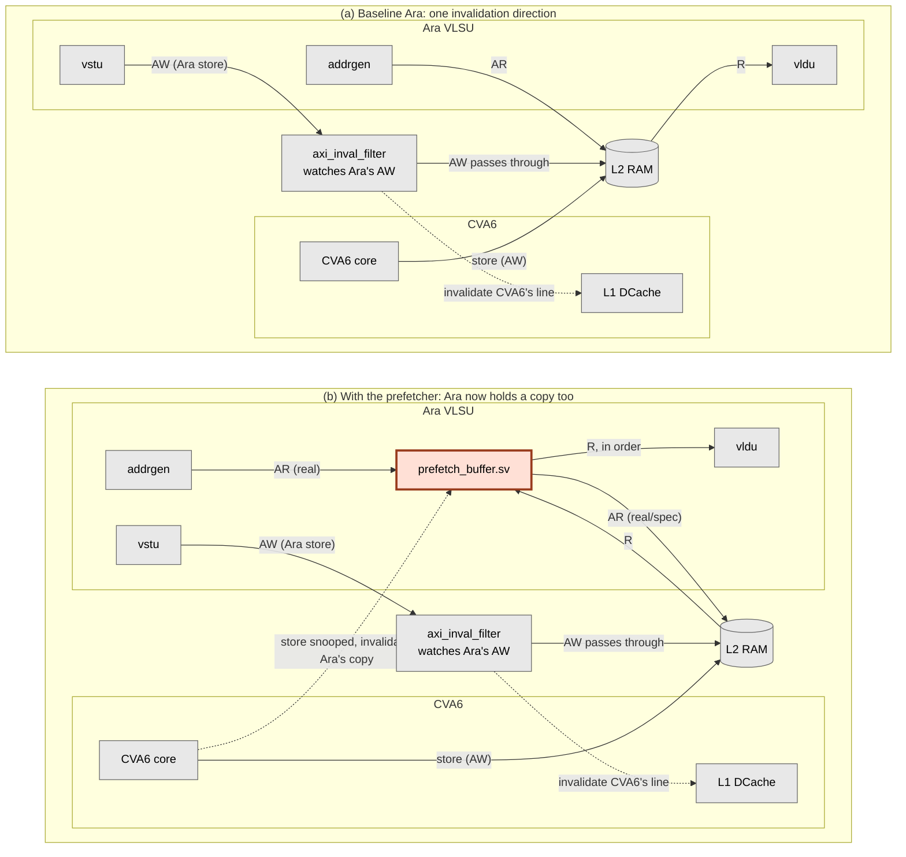
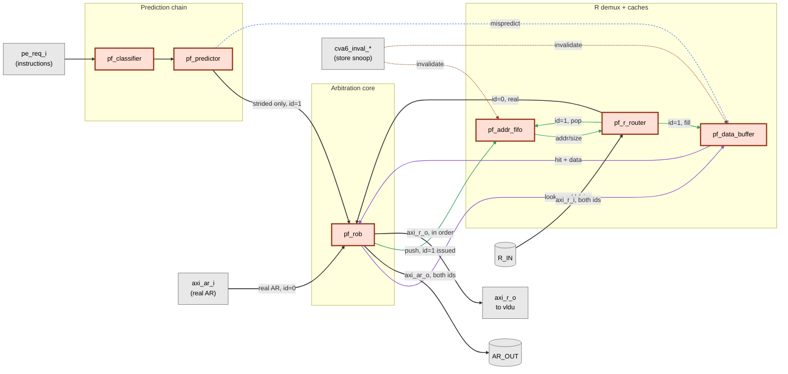

# A Hardware Prefetcher for Vector Loads in Ara's VLSU

**ECE 499 Engineering Project, Final Report**

**Student:** Catherine Ye
**Supervisor:** Professor Hiren Patel
**Term:** Spring 2026
**Date:** August 14, 2026

---

## Summary

Ara is an open-source RISC-V vector coprocessor. Its vector load/store unit (VLSU) sends every AXI memory request with the same transaction ID. AXI4's per-ID ordering rule keeps the responses arriving at the vector load unit (vldu) in program order. I added a hardware prefetcher to this load path.

Most CPU prefetchers infer a stride from earlier addresses. A RISC-V Vector (RVV) load already describes its access pattern. The classifier can read the stride from the instruction, leaving the predictor to decide whether a later load will continue it.

The prefetcher watches PE requests entering the VLSU. It classifies each vector load and predicts the next base for a continuing pattern. A three-state confidence FSM controls when the prediction can be used. Once confidence rises, a strided load may issue one speculative AXI read before the later load produces its real request. I limited this path to strided loads because unit-stride loads already use bursts. Returned data waits in a small buffer. A reorder buffer stops a ready hit from passing an older miss.

The buffer introduces a coherency problem because baseline Ara keeps no local memory copy. A CVA6 store can make prefetched data stale before software synchronisation takes effect. The prefetcher watches CVA6 store addresses to catch this case. It clears matching resident data, and it poisons a matching in-flight fetch so the response is dropped when it returns.

The implementation adds seven SystemVerilog modules. Five directed unit scenarios exercise ordering and the resident and in-flight coherency cases. The complete CVA6+Ara model builds as a Verilator executable, loads a real RVV ELF, and passes all 14 cases in Ara's existing strided-load (`vls`) regression. This is functional evidence. It does not show a speedup because the design has no prefetch-hit or bandwidth counters and no representative enabled/disabled benchmark yet.

---

## Table of Contents

1. Introduction
2. Background: How Ara's Memory Path Works
3. Design
   3.1 Scope and Constraints
   3.2 Architecture
   3.3 Module Breakdown
   3.4 Key Design Decisions
   3.5 Coherency
4. Verification
   4.1 Unit-Level Verification
   4.2 System Integration
   4.3 Full-System Functional Simulation
5. Results
6. Limitations, Recommendations and Future Work
   6.1 Performance Evaluation
   6.2 Architecture Extensions
7. Conclusion
References

---

## 1. Introduction

Ara [1] is an open-source vector coprocessor that runs beside the CVA6 [2] scalar core. In this simulation, the L2 SRAM model answers in one cycle. AXI cuts and the interconnect still add delay between the VLSU and memory. If the access pattern is known early, a prefetcher may hide part of that delay.

Conventional CPU prefetchers derive a stride from earlier addresses. IP-stride prefetchers and SPP [3] follow that approach. RVV already identifies `vle` as unit-stride, while `vlse` carries its stride in a scalar register. This project uses those instruction fields in a prefetcher inside Ara's VLSU.

---

## 2. Background: How Ara's Memory Path Works

Before starting the design, I traced Ara's memory path through `addrgen.sv`, `vlsu.sv`, `vldu.sv` and `vstu.sv`. Three details shaped the prefetcher.

**Every AXI request Ara issues uses transaction ID 0.** Unit-stride, strided and indexed accesses build their AR packets in three different places. Each packet starts from `default: '0'`, and none of those paths sets `id`. Ara relies on AXI4 to return requests with the same ID in order. It has no request tags or internal reordering at this point. `vldu` also has no reorder buffer or ID-indexed scoreboard. The prefetcher must preserve the issue order seen by `vldu`.

**`vldu` gets addresses from a side metadata queue, never from the R channel.** The same cycle `addrgen` issues an AR or AW, it pushes `{addr, size, len, is_load, is_exception}` into a shared `fifo_v3`. `vldu` and `vstu` take the head entry, one or the other. When R data arrives, `vldu` reads only `axi_r_i.data`, and it gets the address and width for the valid byte window from the metadata queue head. Nothing in the file reads `axi_r_i.id` or `axi_r_i.resp`. The queue stays lined up on its own as long as R order matches AR issue order, so a prefetcher can leave it alone.

**The AXI4 R channel carries no address.** It has `id`, `data`, `resp`, `last` and `user`. AXI matches a returning beat through per-ID ordering. Ara can rely on this because its traffic uses `id=0`. The prefetcher still needs the address so it can tag buffered data. It must record that address when the speculative request leaves.

---

## 3. Design

### 3.1 Scope and Constraints

The classifier and predictor recognize `vle` and `vlse`, which represent unit-stride and strided loads. Only `vlse` can issue a speculative AXI request in the current design. Indexed loads (`vlxe`) are out of scope because their addresses live in a vector register and only exist at runtime. Stores are never prefetched.

Segment loads need separate attention. Ara carries the segment count in `nf`, while the backend operation remains `VLE` or `VLSE`. The classifier sees that operation after `segment_sequencer.sv` breaks the load into micro-ops, so segment-derived micro-ops follow the normal classification. Each strided micro-op has a concrete base and stride. Benchmarks are still needed to tell whether prefetching these operations helps.

Only strided loads produce speculative AXI reads. The predictor uses the PE instruction ID to recognize a new request without firing again while that request is held. Once confidence has been established, a qualifying instruction can produce one read for the predicted base. Unit-stride loads still update the classifier and predictor but do not reach the speculative AR channel. Section 3.5 covers coherency with CVA6 stores.

### 3.2 Architecture

`prefetch_buffer.sv` sits between `addrgen` and the AXI cut. The integration leaves `addrgen.sv`, `vstu.sv`, `vldu.sv` and the shared metadata FIFO unchanged. Figure 1 shows this placement.

**Figure 1: System-level block diagram, before and after.** Panel (a) is baseline Ara. Panel (b) adds this project's contribution, the shaded block. Everything else is existing Ara and CVA6 infrastructure. Only the channels each block acts on are drawn, so `axi_inval_filter` appears on the store path alone, even though Ara's other AXI channels physically pass through it untouched.

Baseline Ara keeps no local copy of memory, so it needs only one invalidation direction. `axi_inval_filter` sits in Ara's write path and watches Ara's AW channel. It sends each accepted store address to CVA6, which drops the matching L1 line. The module belongs to Ara's path even though it protects CVA6's cache.

`prefetch_buffer.sv` adds a local copy inside Ara, which requires the second invalidation direction shown in panel (b). Section 3.5 explains how the buffer handles a snooped CVA6 store.

### 3.3 Module Breakdown

Figure 2 expands the shaded block. The classifier and predictor produce a candidate address. `pf_rob` owns the shared AR channel and the release order to `vldu`, while `pf_r_router` separates returning data by ID. The remaining modules hold speculative addresses and data.

**Figure 2: Inside `prefetch_buffer.sv`.** The seven modules are new. Grey blocks mark external ports. Real traffic uses `id = 0`; speculative traffic uses `id = 1`. `pf_rob` merges them onto one AR channel, and `pf_r_router` separates the returning data. The line colours distinguish the main data flow, buffer lookup, speculative bookkeeping, mispredict flush and coherency invalidation.

| Module | Responsibility |
|---|---|
| `prefetch_buffer.sv` | The top level, and the only module `vlsu.sv` instantiates. Wiring only, with no decision logic of its own. It instantiates the six below, packages a granted prediction into a single-beat AR with `id = 1`, and fans the CVA6 store snoop out to the two structures that hold copies of memory. |
| `pf_classifier.sv` | Decodes `vle` and `vlse` into `{prefetchable, byte_stride, size, is_strided}` straight from the instruction fields. RVV encodes the pattern, so nothing has to be inferred. Indexed loads and stores fall through as not prefetchable. Segment-derived micro-ops are classified according to the `VLE` or `VLSE` operation they carry, as Section 3.1 explains. |
| `pf_predictor.sv` | Predicts the next instruction's base address as `scalar_op + vl × byte_stride`. One formula covers both `vle` and `vlse`, since the classifier already supplies `byte_stride`. A 2-bit saturating confidence FSM gates the output: `NO_PRED → TRANSIENT → STEADY`, and one mispredict drops it straight back to `NO_PRED`. Only strided predictions get past that gate (Section 3.4). Unit-stride ones still update the FSM, then get dropped here and never reach the AR channel. |
| `pf_addr_fifo.sv` | Records `{addr, size}` for every outstanding speculative AR, in issue order, since AXI's R channel does not echo the address back. Its occupancy doubles as the throttle. A full FIFO withholds the grant for the next speculative AR, so no separate in-flight counter is needed. |
| `pf_rob.sv` | The correctness-critical module. It arbitrates real misses against speculative ARs for the shared AR channel, and a real miss always wins. A buffer hit uses no AR bandwidth, so a speculative request may issue in the same cycle. The ROB releases R data to `vldu` strictly in the order the real requests arrived. How a request resolved, by buffer hit or by real miss, makes no difference to when it is released. |
| `pf_r_router.sv` | Splits returning R data by ID. A speculative result whose `resp` is not `OKAY` gets dropped instead of cached. It routes on `id == 1` and treats everything else as real traffic, which works because this design adds the only second ID in the system. |
| `pf_data_buffer.sv` | A small fully-associative cache of speculative results, keyed on `{addr, size}`. Keying on `addr` alone would let a wider access hit an entry cached for a narrower one, handing back bytes that were never fetched. Depth is a parameter, currently 4. |

### 3.4 Key Design Decisions

**Prediction is PE-request-triggered and one step ahead.** The first qualifying PE request establishes a candidate for the next base. A later matching request raises confidence and may trigger one speculative AR for the following base, before that following instruction has produced a real AR of its own.

**Only strided loads issue prefetches.** A unit-stride load uses a burst AR, which spreads the memory round trip over many elements. A strided load sends one small AR per element and pays that round trip repeatedly. A wrong unit-stride prediction also wastes a whole burst, while a wrong strided prediction wastes one small request. I kept unit-stride loads in the classifier and confidence FSM but blocked their speculative ARs.

**The address-tracking FIFO replaces the missing R-channel address.** A returning speculative beat needs the original `{addr, size}` before it can enter the data buffer. AXI does not return that information, so the FIFO records it when the AR request leaves. Its push and pop sequence follows the metadata FIFO that `addrgen` already uses for real traffic.

**The hit key is `{addr, size}`.** Element width matters even when two loads use the same address. A `vlse32` entry at address A cannot satisfy a later `vlse64` request to A. The `size` field records this per-beat width. The buffer does not store `len` because every speculative AR contains one beat. For the same reason, `pf_rob` only accepts a buffer hit when the real request has `len == 0`; multi-beat bursts go to memory.

**The release path uses a reorder buffer.** A speculative hit may become ready while an older real miss is still outstanding. The ROB records either completion and releases data only from the head. Hits and misses use the same release path.

**Buffer entries use two states.** An entry is `empty` or `valid`. It becomes valid when data arrives. If a real request reaches an address that is still being prefetched, the current design sends another read. A third in-flight state could remove that duplicate request and remains future work.

**`pf_addr_fifo` stays intact after a mispredict.** It records requests that have already left the VLSU. Those responses will still return, so clearing the FIFO would break its alignment with the bus. `pf_r_router` would pop the wrong `{addr, size}` and could file returned data under a stale key. A later real load might then consume data from another address. Keeping the FIFO costs little. A late response is stored under its original key and may only become a useless prefetch. The poisoned bits used for coherency also live in this FIFO, so preserving it keeps those bits until the matching response arrives.

### 3.5 Coherency

`axi_inval_filter.sv` already watches Ara's store addresses and asks CVA6 to invalidate the matching L1 line. The prefetch buffer also needs the reverse path so it can see CVA6 stores.

Baseline Ara sends loads straight to the bus and keeps no local copy. The prefetch buffer reads early and holds the result. A later CVA6 store can make that result stale, so the hardware must invalidate it directly.

The mechanism snoops CVA6's AXI write-address channel, tapped in `ara_system.sv` after the CVA6-side width converter and before the shared AXI mux. On every accepted CVA6 store it checks two structures:

- **`pf_data_buffer.sv`.** Any resident entry whose byte range overlaps the store's range is cleared that cycle.
- **`pf_addr_fifo.sv`.** A store can land on an address whose speculative fetch has not returned yet, so no buffer entry exists to clear. This race is real and has to be handled explicitly, since nothing else in the design orders CVA6's stores against Ara's speculative reads. This is why `pf_addr_fifo.sv` uses an explicit indexed array instead of an opaque `fifo_v3` wrapper. A matching in-flight entry gets marked poisoned instead, and when its data eventually arrives, `pf_r_router.sv` drops it.

The snoop stays active in every mode. `acc_cons_en` gates `axi_inval_filter`, but instruction-level ordering cannot cover data read speculatively ahead of the instruction. An unconditional snoop may discard a usable prefetch, though it avoids leaving stale data in the buffer.

---

## 4. Verification

### 4.1 Unit-Level Verification

`unit_smoke_tb.sv` connects `pf_rob.sv` to `pf_data_buffer.sv` and instantiates `pf_addr_fifo.sv` separately. It targets in-order release and coherency, where a bug could return incorrect data without an obvious failure. Running `make simv_unit` from `hardware/` builds and executes five scenarios. Each prints a `[PASS] stepN: ...` line.

- A cold miss forwards correctly.
- A buffer hit releases without touching the real AXI channel.
- A younger hit stays blocked behind an older outstanding miss.
- A CVA6 store invalidates a resident buffer entry, so the next access to that address misses instead of returning stale data.
- A CVA6 store lands on a fetch that is still in flight. It has to poison the one overlapping `pf_addr_fifo` entry and no other, and pop order has to stay equal to push order.

The last scenario covers the in-flight half of the coherency mechanism. It instantiates `pf_addr_fifo` on its own, since this testbench has no predictive AR path to reach it through.

The five scenarios target ordering and coherency. They do not provide exhaustive module coverage.

### 4.2 System Integration

Running `make verilate` from `hardware/` builds the full system: CVA6, Ara, the prefetcher and the coherency snoop. Verilator elaborates the RTL with no port mismatches, missing connections or type errors. The generated C++ model then compiles and links with the ELF loader and SRAM DPI exports, producing `hardware/build/verilator/Vara_tb_verilator`. The build emits warnings in existing Ara and dependency RTL, but none points to a missing or mismatched prefetcher connection.

### 4.3 Full-System Functional Simulation

I used Ara's existing `rv64uv-ara-vls` regression for the full-system run. Its compiled RVV ELF is loaded into simulated SRAM and executed by CVA6 and Ara through the modified VLSU. `make rv64uv-ara-vls` runs 14 cases. All passed, and the testbench ended with `Core Test *** SUCCESS *** (tohost = 0)` after `0x7cd0` simulated cycles.

The first link attempt failed because the dependency checkout did not match `Bender.lock`. Verilator's C++ harness (`dpi_memutil.cc`) needs the `simutil_set_mem` and `simutil_memload` DPI exports supplied by `hardware/patches/0001-tech-cells-generic-sram.patch`. The local checkout used a newer `tech_cells_generic` revision, so the patch had not been applied. Restoring the locked revision and running `make apply-patches` supplied both symbols. The installed `libelf` headers and library then linked the ELF loader.

The directed tests cover the new ordering and coherency state. The successful `vls` run adds a full-system check with real RVV code. The tested strided loads remain architecturally correct after integration. The run does not count speculative requests or buffer hits, so it gives no evidence of prefetch activity or speedup.

---

## 5. Results

### 5.1 Verification Results

- **Implementation.** Seven new prefetcher modules share types from `pf_pkg`. Three existing RTL files handle integration: `vlsu.sv` splices the AR/R path and carries the coherency signals, while `ara.sv` and `ara_system.sv` pass the store snoop through. The build files and unit harness include the new modules.
- **5/5 unit-level scenarios pass.** A hit cannot pass an older miss on the way to `vldu`. The tests also cover a store against resident data and a store against an in-flight fetch.
- **Full-system executable built.** CVA6 plus Ara plus the prefetcher elaborates, compiles and links under Verilator with the repository's SRAM DPI patch and the ELF-loading harness.
- **14/14 full-system RVV strided-load cases pass.** Ara's existing `rv64uv-ara-vls` ELF runs through the complete model and reports `Core Test *** SUCCESS *** (tohost = 0)`. The run reuses Ara's test program and system harness. This project did not add a new benchmark for it.

### 5.2 Performance

I did not evaluate performance in this project. A useful comparison would run representative strided-load workloads with prefetching enabled and disabled, then compare total cycles, prefetch hit rate and extra memory traffic. The `vls` result in Section 5.1 is a correctness result only. Its `0x7cd0` cycle count is not evidence of speedup.

---

## 6. Limitations, Recommendations and Future Work

### 6.1 Performance Evaluation

The full-system flow can now run a controlled prefetcher-on and prefetcher-off comparison. It still needs counters for execution cycles, prefetch hits, speculative requests and wasted bandwidth, along with representative vector workloads.

### 6.2 Architecture Extensions

- **Multi-step lookahead and adaptive prefetch degree.** The current predictor generates at most one speculative AR for each qualifying PE request. A later version could generate `A + d`, `A + 2d`, ..., `A + Nd` from one confirmed pattern, where `d = vl × byte_stride`. Confidence, buffer occupancy and available bandwidth could control `N`. This extension would also need rules for page boundaries, address overflow, cancellation and added AR pressure.
- **Unit-stride prefetching.** Currently observe-only, for the reasons in Section 3.4. Turning it on needs the burst-granularity redesign that path would require.
- **In-flight de-duplication.** The three-state buffer design set aside in Section 3.4 stays a reasonable optimization to revisit once the two-state design has been measured against real workloads.

---

## 7. Conclusion

The prefetcher uses RVV instruction fields to classify each access. It only predicts whether a later instruction continues the pattern. Its placement and ordering logic follow Ara's existing AXI path, including the in-order response stream on `id = 0`.

Five directed unit scenarios pass. The complete CVA6+Ara model also builds and passes all 14 cases in Ara's strided-load regression. These checks cover the main ordering and coherency risks, and the tested RVV loads still execute correctly after integration.

The report makes no performance claim. The current evidence has no representative enabled/disabled benchmark and no count of useful or wasted requests. Those measurements should come before the larger extensions in Section 6.

---

## References

1. M. Cavalcante, F. Schuiki, F. Zaruba, M. Schaffner, and L. Benini, "Ara: A 1-GHz+ Scalable and Energy-Efficient RISC-V Vector Processor With Multiprecision Floating-Point Support in 22-nm FD-SOI," *IEEE Transactions on Very Large Scale Integration (VLSI) Systems*, vol. 28, no. 2, pp. 530–543, Feb. 2020, doi: [10.1109/TVLSI.2019.2950087](https://doi.org/10.1109/TVLSI.2019.2950087).
2. F. Zaruba and L. Benini, "The Cost of Application-Class Processing: Energy and Performance Analysis of a Linux-Ready 1.7-GHz 64-Bit RISC-V Core in 22-nm FDSOI Technology," *IEEE Transactions on Very Large Scale Integration (VLSI) Systems*, vol. 27, no. 11, pp. 2629–2640, Nov. 2019, doi: [10.1109/TVLSI.2019.2926114](https://doi.org/10.1109/TVLSI.2019.2926114).
3. J. Kim, S. H. Pugsley, P. V. Gratz, A. L. N. Reddy, C. Wilkerson, and Z. Chishti, "Path confidence based lookahead prefetching," in *Proc. 49th Annual IEEE/ACM International Symposium on Microarchitecture (MICRO)*, article 60, pp. 60:1–60:12, Oct. 2016, doi: [10.1109/MICRO.2016.7783763](https://doi.org/10.1109/MICRO.2016.7783763).
4. pulp-platform, "Ara," GitHub repository. [Online]. Available: [https://github.com/pulp-platform/ara](https://github.com/pulp-platform/ara).
5. OpenHW Group, "CVA6 RISC-V CPU," GitHub repository. [Online]. Available: [https://github.com/openhwgroup/cva6](https://github.com/openhwgroup/cva6).

---

*End of draft. Page count still needs checking once this is rendered into the submission format.*
